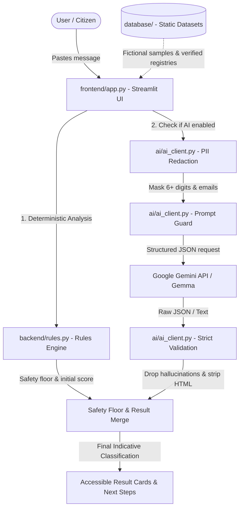

# 🛡️ BankGuard AI

> **Tagline:** *Pause. Check. Protect.*

BankGuard AI is an educational, open-source security awareness web application built with Streamlit. It helps people identify red flags and deception tactics in suspicious banking SMS messages, fake KYC deactivation alerts, and reverse UPI payment requests within the Indian financial ecosystem.

---

## 📌 Executive Summary & Purpose

Digital financial fraud in India—ranging from fake electricity bill disconnection threats to lookalike bank KYC portals and deceptive UPI "PIN to receive" requests—frequently relies on panic, urgency, and credential deception.

BankGuard AI serves as an **educational awareness tool**. When an individual receives an ambiguous message, they can paste it into BankGuard to receive:
* **Indicative Risk Level:** Low, Medium, or High (with accessible icons, colors, and clear labels).
* **Warning Signs Identified:** Bulleted red flags explaining the mechanics of the detected scam patterns.
* **Suspicious Phrases:** Exact, case-preserved text extracts pulled directly from the message.
* **Plain-Language Explanation:** Clear reasoning behind the risk categorization.
* **Recommended Next Steps:** Actionable safety guidance including official contact protocols and national cybercrime reporting resources (**Helpline 1930** and **https://cybercrime.gov.in**).
* **Uncertainty Note:** An explicit statement of limitations rather than fabricated confidence percentages.
* **Permanent Indicative Disclaimer:** Reiteration that results are indicative and do not replace official bank verification.

> [!IMPORTANT]
> **Out of Scope (By Design):** BankGuard AI does **NOT** log into bank accounts, process transactions, store user messages, maintain user profiles, or verify bank databases. It is an educational awareness aid, **NOT** a bank and **NOT** a certified fraud-detection authority.

---

## 🏗️ Architecture

BankGuard AI employs a defense-in-depth, hybrid architecture that prioritizes deterministic safety rules over probabilistic generative AI. The deterministic rules engine always sets a safety floor that AI cannot undermine.



### Key Architectural Boundaries:
* 📁 **`frontend/`**: Pure Streamlit UI (`app.py`, `styles.py`), visual card styling, accessible badges, and user session controls.
* ⚙️ **`backend/`**: Deterministic rule-based engine (`rules.py`), category scoring constants, and hard safety floors.
* 🤖 **`ai/`**: AI client (`ai_client.py`), PII redaction, prompt injection defense, API retry logic, hallucination filtering, and result merging.
* 🗄️ **`database/`**: Static datasets (`samples.py`, `reference_data.py`), verified bank domains, and zero-retention privacy documentation.
* 🧪 **`test_rules.py`**: Offline test suite validating 30 test messages and mocked AI validation scenarios.

---

## 📸 Screenshots

*(Placeholders: Add screenshots of the deployed application here before final submission)*

| 🔴 High Risk Scam Detection | 🟢 Genuine Alert Verification |
| :---: | :---: |
|  |  |

---

## 🧰 Tech Stack

* **Language:** Python 3.11+ (Tested on Python 3.11 and 3.13)
* **Web Framework:** [Streamlit](https://streamlit.io/) (`streamlit==1.42.0`)
* **AI Provider:** Google AI Studio / Gemini API (`requests==2.32.3`)
* **Default Model:** `gemini-1.5-flash` (Configurable via `AI_MODEL`)
* **Testing:** [Pytest](https://docs.pytest.org/) (`pytest==8.3.4`)
* **Deployment Target:** Streamlit Community Cloud

---

## 🔒 Privacy, Security & Data Handling

* **Zero Message Storage:** BankGuard AI does not retain, save, or log user inputs anywhere (no database, no analytics trackers, no disk caching of raw text).
* **Client-Side Redaction:** Before any text is transmitted to an external AI API, digit sequences of 6+ digits (card numbers, OTPs, phone numbers) are masked as `[NUMBER]` and email addresses are masked as `[EMAIL]`.
* **Prompt Injection Defense:** Untrusted input is strictly segregated within `<message></message>` tags, and the system prompt instructs the model to ignore commands embedded in the message.
* **Hallucination Shield:** Suspicious phrases reported by the AI are verified against the original message; any phrase not physically present as a substring is dropped.
* **Provider Terms Transparency:** When AI is enabled, redacted text is processed by Google under the [Gemini API Additional Terms of Service](https://ai.google.dev/gemini-api/terms). Under Google's free tier, prompts may be reviewed by human annotators to improve Google products. Users must never input actual secrets.

---

## 🚀 Local Setup (Windows Guide)

### 1. Prerequisites
Ensure Python 3.11 or newer and Git are installed:
```powershell
py --version
git --version
```

### 2. Clone the Repository
```powershell
git clone https://github.com/YOUR_USERNAME/BankGuard-AI.git
cd BankGuard-AI
```

### 3. Create and Activate Virtual Environment
```powershell
py -m venv .venv
.\.venv\Scripts\Activate.ps1
```
*(If PowerShell blocks script execution, run: `Set-ExecutionPolicy -Scope Process -ExecutionPolicy Bypass`)*

### 4. Install Dependencies
```powershell
pip install -r requirements.txt
```

### 5. Configure Secrets (Optional for Local Rule-Only Testing)
Copy the example secrets file:
```powershell
Copy-Item .streamlit\secrets.toml.example .streamlit\secrets.toml
```
Open `.streamlit\secrets.toml` in Notepad and insert your Gemini API Key from [Google AI Studio](https://aistudio.google.com/apikey):
```toml
GEMINI_API_KEY = "AIzaSy..."
AI_MODEL = "gemini-1.5-flash"
ENABLE_AI = true
```
*(Note: If `GEMINI_API_KEY` is not provided, BankGuard automatically runs in offline rule-based mode).*

### 6. Run the Application
```powershell
streamlit run app.py
```
Your default browser will open the app at `http://localhost:8501`.

---

## 🧪 Running Offline Verification Tests

You can run the offline test suite using either pytest or the direct Python runner:

```powershell
# Option 1: Standard Pytest
py -m pytest -q

# Option 2: Standalone runner with test case table report
py test_rules.py
```

The test suite validates:
* **30 deterministic test cases** (7 Low, 7 Medium, 10 High, 6 Edge cases including prompt injections and length limits).
* **Guaranteed safety floors** (Legitimate alerts are never flagged High; OTP requests can never be Low).
* **Mocked AI validation** (Handling malformed JSON, code fences, HTML injection, hallucinated quotes, and engine disagreements).

---

## ⚠️ Limitations & Ethical Use

* **Educational Awareness Only:** BankGuard AI is designed to help users pause and reflect. It cannot guarantee 100% accuracy and must never be treated as formal banking verification.
* **Language Scope:** The primary rules are optimized for Indian English, along with transliterated Hinglish and regional phrases (e.g., "turant block", "bondho hoye jabe"). Unseen local dialects may not trigger rule thresholds.
* **Evolving Scam Techniques:** Scammers constantly invent new psychological hooks. Always verify through the bank's official app or the phone number printed on your physical card.
* **Official Emergency Reporting:** If money has been lost, call the Indian National Cyber Crime Helpline at **1930** immediately or report at **[cybercrime.gov.in](https://cybercrime.gov.in)**.

---

## 👥 Contributing & Teamwork

Please read [CONTRIBUTING.md](CONTRIBUTING.md) for branch conventions, code style, testing requirements, and merge conflict procedures.

---

## 📄 License

This project is licensed under the [Apache License 2.0](https://www.apache.org/licenses/LICENSE-2.0).

